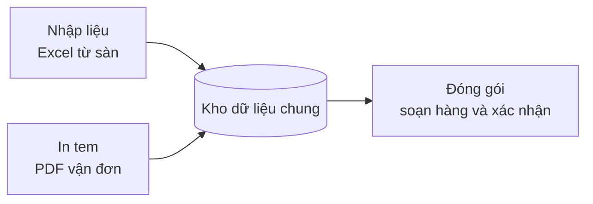

# Hệ thống Quản lý Đơn hàng & Đóng gói

Portfolio Business Analyst — dự án kết nối **bán hàng đa kênh (Shopee, TikTok Shop)** với **bên đóng gói bên thứ ba**, dùng chung một kho dữ liệu.

> ⚠️ **Về tài liệu này.** Đây là bộ tài liệu **viết lại (retrospective)** từ hồ sơ bàn giao của một dự án thực tế đã chạy. Tên doanh nghiệp, mã truy cập, đường dẫn hệ thống và dữ liệu đơn hàng thật đã được **ẩn danh/loại bỏ**. Mã yêu cầu (BR-01, FR-01…) do mình đặt khi tái cấu trúc để tiện truy vết.

## Bài toán trong 30 giây

Doanh nghiệp bán trên 2 sàn, mỗi sàn xuất file Excel đơn hàng theo một định dạng khác nhau, tên sản phẩm trên sàn dài và khó hiểu. Bên đóng gói là một đơn vị khác, cần biết **đơn nào chưa đóng, đóng món gì, đã đóng chưa**.

**Giải pháp:** 3 luồng nghiệp vụ tách riêng, nối với nhau bằng một khoá chung (mã vận đơn hoặc mã đơn hàng), dữ liệu dùng chung trên một bảng tính trực tuyến.

## Mục lục tài liệu

| # | Tài liệu | Nội dung |
|---|---|---|
| 1 | [Bối cảnh & mục tiêu](docs/01-boi-canh-va-muc-tieu.md) | Vấn đề, các bên liên quan, mục tiêu, phạm vi |
| 2 | [BRD — Yêu cầu nghiệp vụ](docs/02-brd-yeu-cau-nghiep-vu.md) | Quy tắc nghiệp vụ, yêu cầu chức năng, phi chức năng, ràng buộc |
| 3 | [User stories](docs/03-user-stories.md) | Câu chuyện người dùng theo vai trò kèm tiêu chí chấp nhận |
| 4 | [Luồng quy trình](docs/04-luong-quy-trinh.md) | Quy trình tổng thể, vòng đời trạng thái, logic quy đổi sản phẩm |
| 5 | [Mô hình dữ liệu (ERD)](docs/05-erd-du-lieu.md) | Các bảng, trường, khoá liên kết, quy tắc chống trùng |
| 6 | [Quyết định đã chốt](docs/06-quyet-dinh-da-chot.md) | Quyết định kèm lý do và phương án đã loại |
| 7 | [Truy vết yêu cầu](docs/07-truy-vet-yeu-cau.md) | Yêu cầu → user story → tính năng → bằng chứng kiểm thử |
| 8 | [Rủi ro & bài học](docs/08-rui-ro-va-bai-hoc.md) | Sự cố thực tế, nguyên nhân gốc, cách xử lý |

## Quản lý công việc

Backlog thực tế được theo dõi bằng **GitHub Issues** và bảng **GitHub Projects** của repo này.

## Vai trò của mình

Business Analyst: làm rõ yêu cầu, mô hình hoá quy trình và dữ liệu, ghi nhận quyết định, và truy vết yêu cầu tới kiểm thử.
