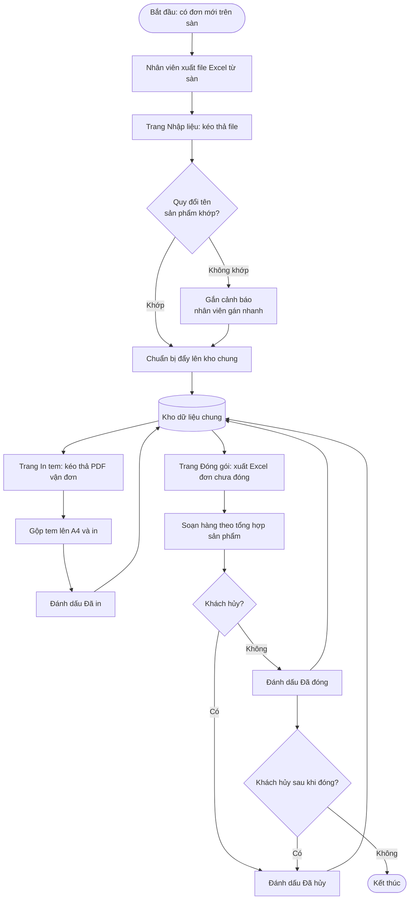
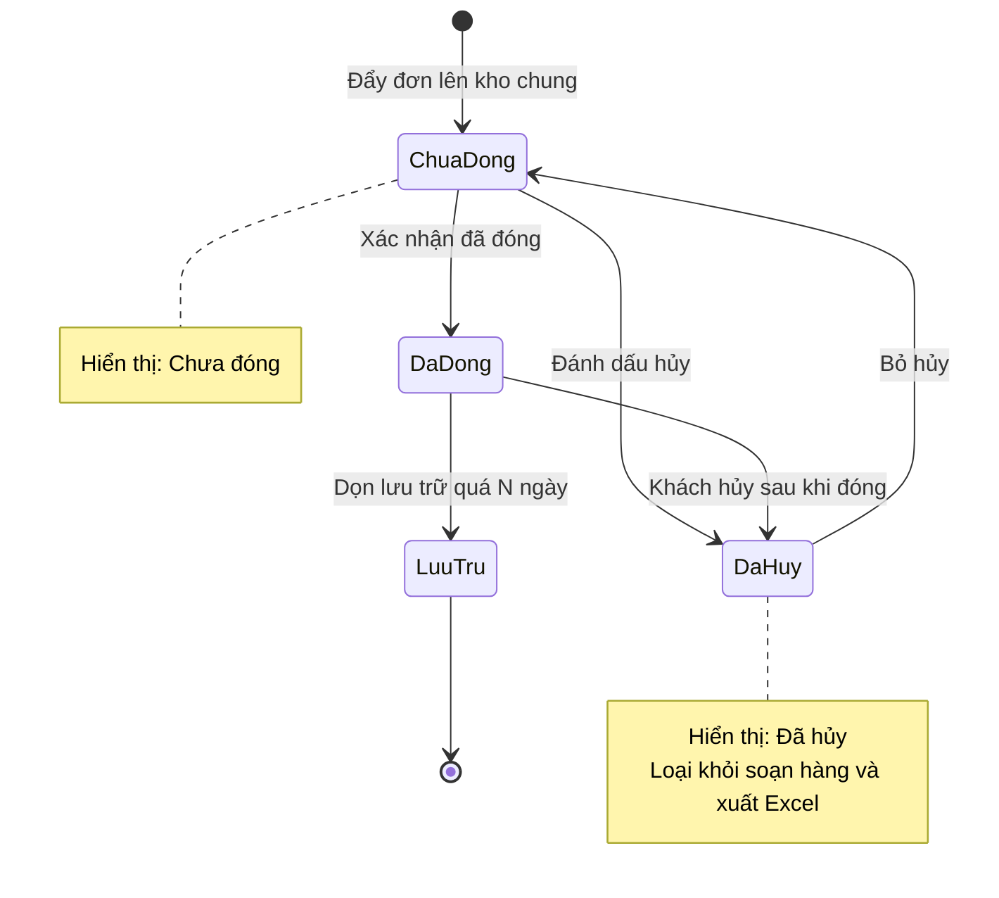
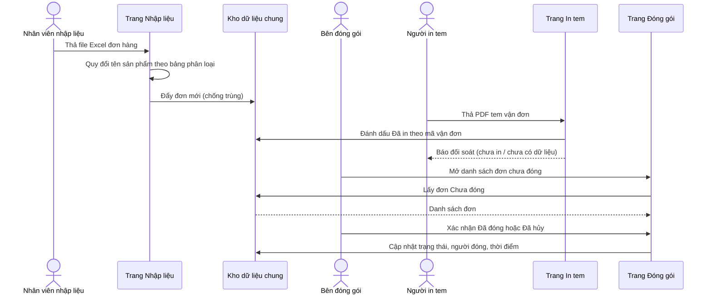
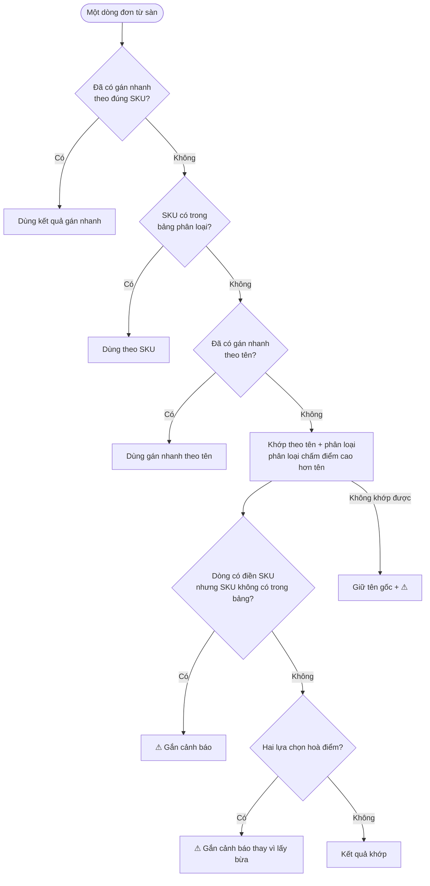

# 4. Luồng quy trình

## 4.1 Quy trình tổng thể

## 4.2 Vòng đời trạng thái đơn

Song song với trạng thái đóng, mỗi đơn có cờ **Đã in** (trống → ✓) được đặt khi in tem.
Quy tắc: không xoá dòng; chỉ đổi trạng thái hoặc chuyển sang trang lưu trữ.

## 4.3 Trình tự giữa các bên

## 4.4 Logic quy đổi tên sản phẩm (quy tắc quyết định)

Đây là phần quan trọng nhất của hệ thống: sai ở đây thì bên đóng gói soạn nhầm hàng.

**Nguyên tắc rút ra:** thà **cảnh báo** còn hơn **lặng lẽ sai**. Mọi nhánh không chắc chắn đều dẫn tới cảnh báo.
