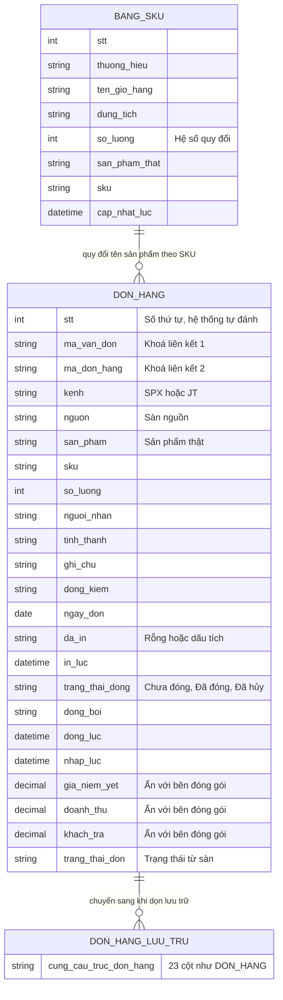

# 5. Mô hình dữ liệu (ERD)

Kho dữ liệu là một **bảng tính trực tuyến** với 3 trang tính. Không có khoá ngoại vật lý; các liên kết là **liên kết logic** theo giá trị.

## 5.1 Trang tính chính — DON_HANG (23 cột)

| Nhóm | Trường |
|---|---|
| Định danh | STT · Mã vận đơn · Mã đơn hàng |
| Nguồn | Kênh · Nguồn |
| Sản phẩm | Sản phẩm · SKU · Số lượng |
| Người nhận | Người nhận · Tỉnh/Thành · Ghi chú · Đồng kiểm |
| Thời gian | Ngày đơn · Nhập lúc |
| In | Đã in · In lúc |
| Đóng gói | Trạng thái đóng · Đóng bởi · Đóng lúc |
| Tiền | Giá niêm yết · Doanh thu · Khách trả |
| Từ sàn | Trạng thái đơn |

**Độ chi tiết:** một dòng = **một sản phẩm thật trong một đơn**. Các trường cấp đơn (đã in, trạng thái đóng…) được lặp lại trên mọi dòng cùng đơn.

## 5.2 Trang tính BANG_SKU — bảng phân loại dùng chung

Mỗi dòng nói: *(Tên giỏ hàng, Dung tích/Phân loại)* → *{Sản phẩm thật, hệ số}*. Đây là một **định mức (BOM)**: một dòng đơn có thể ra nhiều sản phẩm thật.

## 5.3 Quy tắc dữ liệu

| Quy tắc | Nội dung |
|---|---|
| Khoá trùng đơn | `(Mã vận đơn hoặc Mã đơn hàng) + Sản phẩm` |
| Chống trùng 2 mã | Khớp nếu trùng một trong hai mã; khi cập nhật chỉ ghi đè mã khi lần này có mã, không xoá mã cũ |
| Giữ trạng thái | Nhập lại cùng đơn thì giữ STT, Đã in, Trạng thái đóng |
| STT | Do máy chủ đánh nối tiếp, an toàn khi nhiều người cùng đẩy |
| Chống trùng bảng SKU | Theo STT (khi sửa) hoặc khoá nội dung `Tên giỏ hàng + Dung tích + Sản phẩm thật + Số lượng` (khi nạp hàng loạt) |
| Mức độ ưu tiên trạng thái khi gộp | Đã hủy > Đã đóng > Chưa đóng |
| Cắt cột tiền | Vai trò đóng gói nhận 3 cột tiền rỗng |
| Không xoá | Chỉ đổi trạng thái hoặc chuyển sang lưu trữ |

## 5.4 Điểm cần nhớ

- Tên sản phẩm được **ghi cứng tại thời điểm đẩy**. Sửa bảng phân loại về sau **không** tự cập nhật các dòng đã ghi. Xem [Rủi ro & bài học](08-rui-ro-va-bai-hoc.md).
